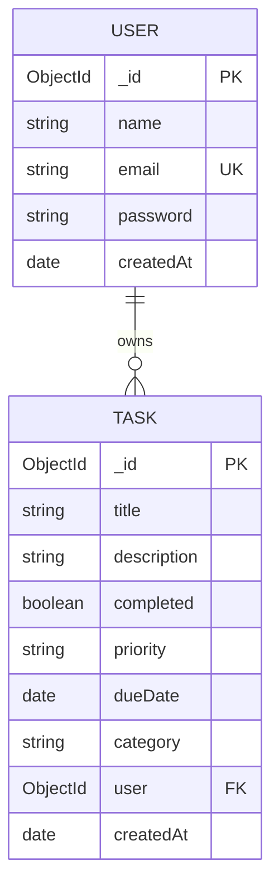

# Database Schema and Relationships

## Collections

### User

| Field | Type | Rules |
|---|---|---|
| `_id` | ObjectId | MongoDB-generated identifier |
| `name` | String | Required, trimmed, 2–80 characters |
| `email` | String | Required, lowercase, unique, valid email format |
| `password` | String | Required, minimum 8 characters; stores bcrypt hash |
| `createdAt` / `updatedAt` | Date | Automatically managed by Mongoose |

### Task

| Field | Type | Rules |
|---|---|---|
| `_id` | ObjectId | MongoDB-generated identifier |
| `title` | String | Required, trimmed, 3–200 characters |
| `description` | String | Optional, maximum 1000 characters |
| `completed` | Boolean | Defaults to `false` |
| `priority` | String | `low`, `medium`, or `high` |
| `dueDate` | Date | Optional |
| `category` | String | `work`, `personal`, `shopping`, `health`, or `other` |
| `user` | ObjectId | Required reference to `User._id` |
| `createdAt` / `updatedAt` | Date | Automatically managed by Mongoose |

## Relationship diagram

One user can own zero or many tasks. Each task belongs to exactly one user. The API uses the authenticated user's ID to scope every task query, so clients cannot assign tasks to another user by sending a `user` field.

## Indexes

- `{ user: 1, completed: 1, createdAt: -1 }` helps retrieve a user's tasks by completion state and newest-first order.
- `{ user: 1, priority: 1 }` helps filter a user's tasks by priority.
- `{ dueDate: 1 }` supports due-date sorting and queries.
- The User email field is unique to prevent duplicate accounts.
